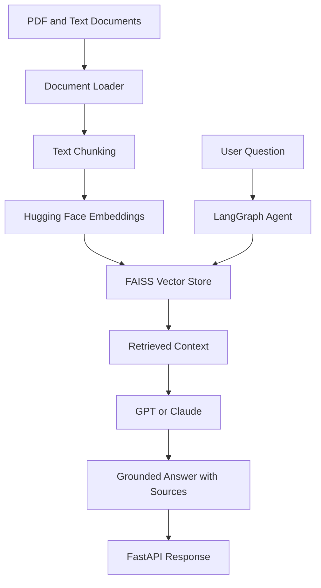

# Enterprise Generative AI & Agentic RAG Platform

An enterprise-style Generative AI project designed to support intelligent document search, contextual question answering, and AI agent workflows using Retrieval-Augmented Generation (RAG).

## Project Overview

The platform combines document ingestion, semantic search, vector databases, and large language models to retrieve relevant information and generate context-aware answers.

### Key Capabilities

- Document ingestion and text chunking
- Hugging Face sentence embeddings
- FAISS vector similarity search
- LangGraph-based agent orchestration
- GPT and Claude LLM integration
- FastAPI REST endpoints
- Source-grounded question answering

**Implementation status:** Document ingestion and text chunking are working. Embedding retrieval, agents, LLM integration, and API endpoints are planned or in development.

## Technology Stack

| Category | Technologies |
|---|---|
| Programming | Python 3.12 |
| GenAI | GPT, Claude, LangChain, LangGraph |
| Embeddings | Hugging Face Sentence Transformers |
| Vector Database | FAISS |
| API | FastAPI |
| Development | VS Code, Git, GitHub |

## System Architecture



## Project Structure

```text
enterprise-genai-agentic-rag/
├── app/
│   ├── document_loader.py
│   ├── embeddings.py
│   ├── rag_pipeline.py
│   ├── agents.py
│   └── main.py
├── data/
│   └── sample.txt
├── docs/
├── tests/
├── requirements.txt
└── README.md
```

## Verified Functionality

The document loader successfully processed a sample text document.

```text
Documents loaded: 1
Chunks created: 1

First chunk preview:
Enterprise Generative AI Platform
Retrieval-Augmented Generation (RAG) combines document retrieval
with large language models to generate grounded answers.
```

## Development Roadmap

- [x] Python environment setup
- [x] Document ingestion and chunking
- [ ] Hugging Face embeddings and FAISS indexing
- [ ] Agentic RAG using LangGraph
- [ ] GPT/Claude API integration
- [ ] FastAPI endpoints
- [ ] Automated tests and evaluation

## Getting Started

Create a Python 3.12 virtual environment and install dependencies:

```powershell
py -3.12 -m venv .venv
.\.venv\Scripts\Activate.ps1
python -m pip install -r requirements.txt
```

Add a sample `.txt` document to the `data` folder and run:

```powershell
python -m app.document_loader
```

## Notes

This is a personal portfolio project under active development. The architecture describes the intended full implementation. No enterprise production deployment is claimed.
